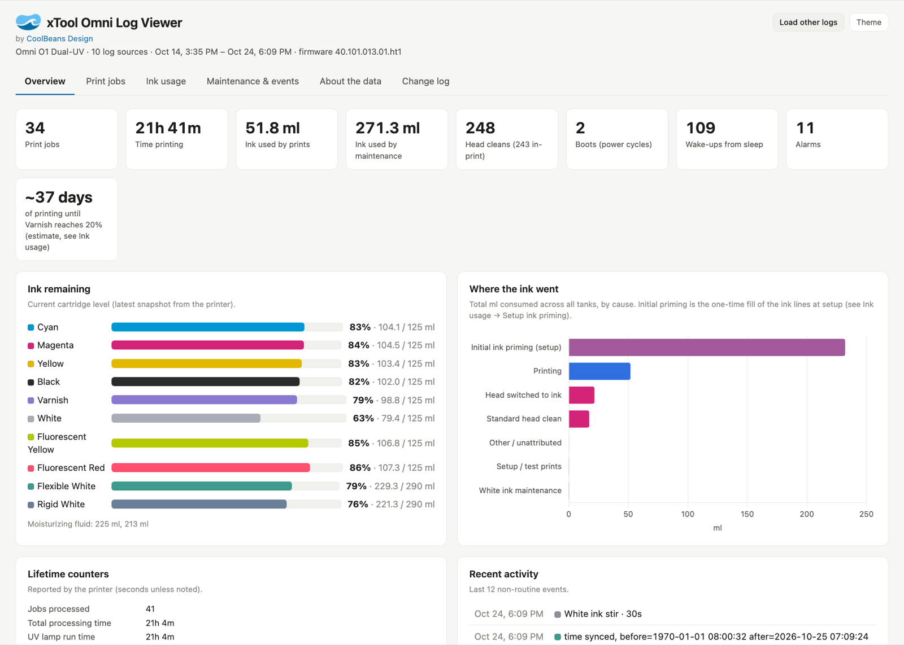
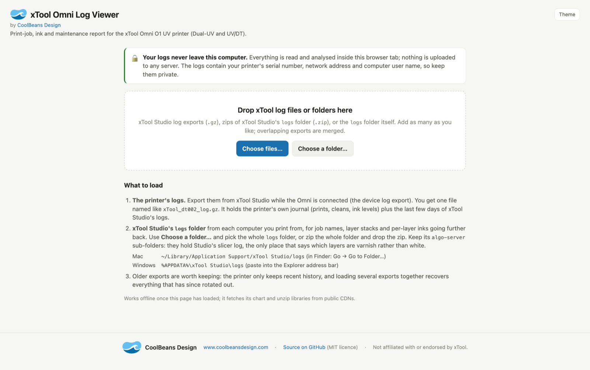
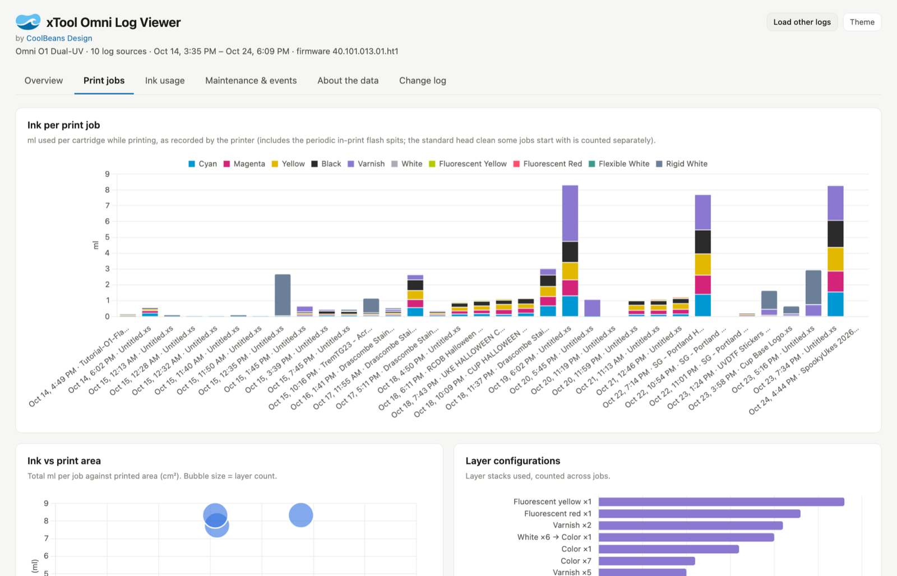
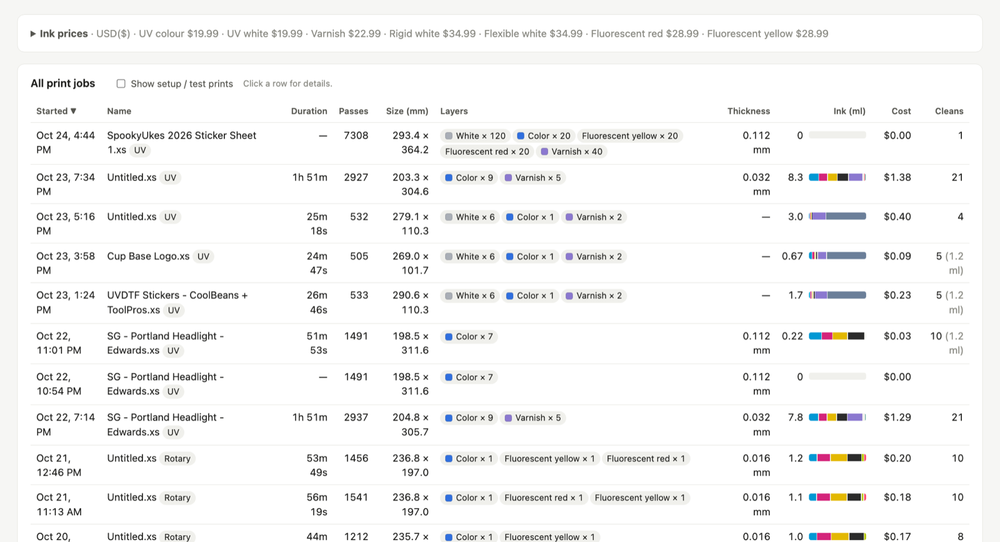
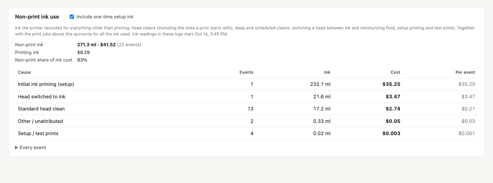
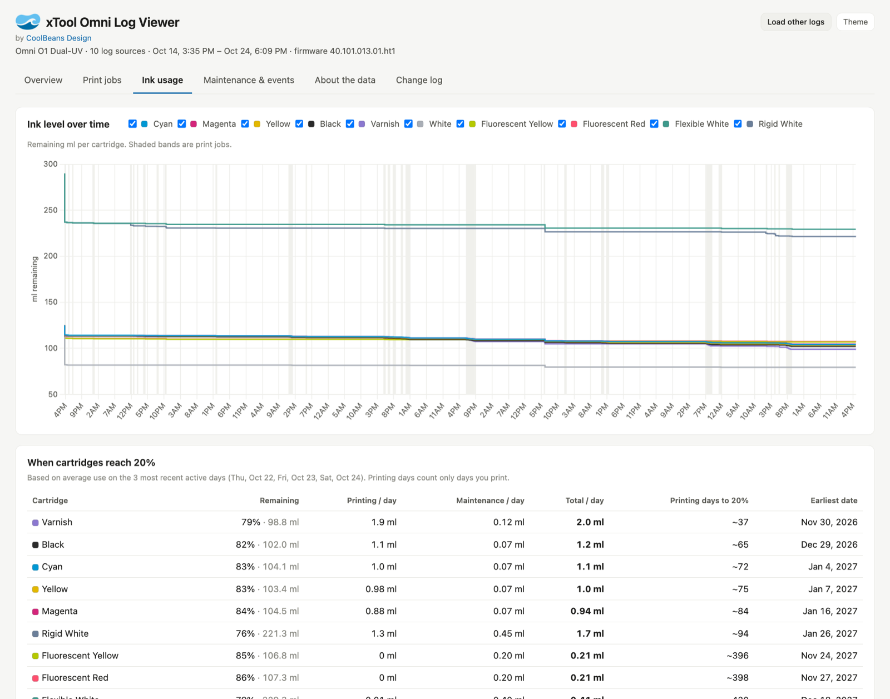
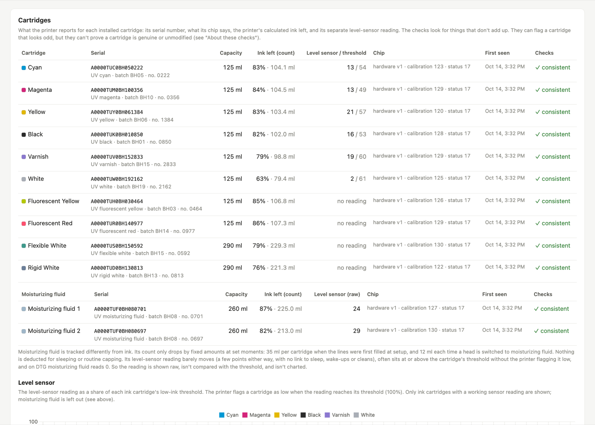
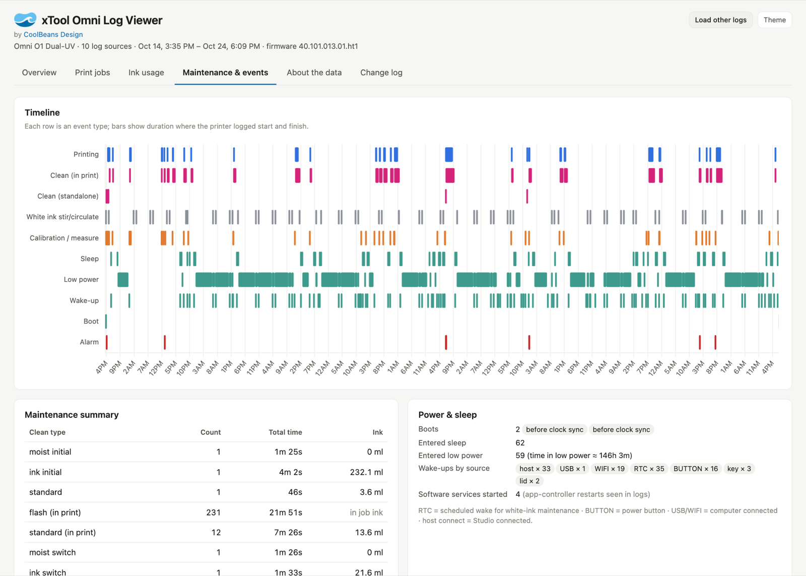
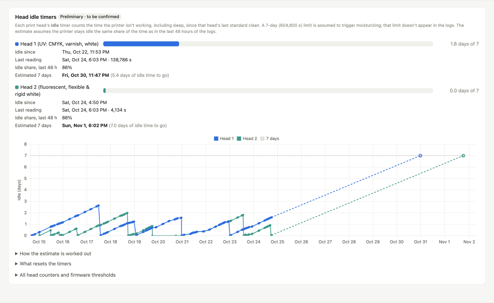

<p align="center"><a href="https://www.coolbeansdesign.com"></a></p>

# xTool Omni Log Viewer

By [CoolBeans Design](https://www.coolbeansdesign.com).

See what your **xTool Omni O1** UV printer (Dual-UV or UV/DT) has been doing: every print job, how much ink each one used, which layers were white, varnish or colour, head cleans, white-ink stirring, sleep and wake-ups, alarms, and how much ink went to maintenance rather than printing.

It reads the log files that xTool Studio can export, and turns them into an interactive report in your web browser.



**Open the viewer:** https://coolbeansdesign.github.io/omni-log-viewer/

**Watch the walkthrough video:** [Omni Log Viewer walkthrough on YouTube](https://www.youtube.com/watch?v=CLJeZrgDYWg). It covers collecting the logs, loading them and reading the report.

> Not affiliated with, endorsed by or supported by xTool. "xTool", "xTool Studio" and "Omni" are xTool's names for their products.

## Your logs stay on your computer

The viewer is a single web page. When you give it your log files they are opened and analysed **inside your browser**. Nothing is uploaded anywhere, and there is no server behind the page. (The page does download its chart and unzip code from public CDNs when it first loads.)

The logs contain your printer's serial number, its network address and your computer's user name, so don't post them publicly.

## How to use it

### 1. Export the printer's logs from xTool Studio

With the Omni connected to xTool Studio, use Studio's **export log** option for the device. It saves one file named like `xTool_dt002_log.gz`. (Despite the `.gz` name it is really a zip, and you don't need to unpack it.)

This file holds the printer's own journal (prints, cleans, ink levels, sleep, alarms) plus the last few days of xTool Studio's logs.

**Keep your old exports.** The printer only keeps recent history. If you load several exports together, the viewer merges them, removes the overlap, and recovers history that has since dropped out of the newer ones.

### 2. (Recommended) Add xTool Studio's `logs` folder

xTool Studio keeps its own logs on every computer you print from. They add job names, sizes and layer stacks for older jobs, and they are the **only place that says which layers were varnish and which were white**.

| Computer | Where the folder is |
| --- | --- |
| Mac | `~/Library/Application Support/xTool Studio/logs` — in Finder choose **Go → Go to Folder…** and paste that path |
| Windows | `%APPDATA%\xTool Studio\logs` — paste it into File Explorer's address bar |

Use the **whole `logs` folder**, including the `algo-server` folders inside the dated folders. You can either:

- pick the `logs` folder directly with **Choose a folder…** on the page, or
- zip it (Mac: right-click → Compress "logs"; Windows: right-click → Send to → Compressed (zipped) folder) and load the zip. This is handy for collecting logs from a second computer.

### 3. Open the viewer and load the files

Open the viewer page and drag your files onto it, or use **Choose files…** / **Choose a folder…**. You can add as many exports and zips as you like, in one go or one after another. The report appears after a few seconds.



You can also download this project and open `index.html` straight from your disk; it works the same way.

## Reading the report

The report has five tabs, plus a Change log.

### Overview

Totals, how much ink is left in each cartridge, where the ink went, lifetime counters, recent activity, and how many days of printing until the first cartridge reaches 20% (shown in the screenshot at the top).

### Print jobs

Ink used by every print job, split by cartridge; ink against print area; and the layer stacks you use most, with white, varnish and colour layers told apart.



The table lists every job with its size, layers, thickness, ink and **cost**. Click a job for its settings, each layer, xTool Studio's ink estimate and any cleans during the print. Set your price per cartridge in **Ink prices**; it starts with xTool Studio's prices.



**Non-print ink use** shows the ink that went on everything else (head cleans, switching a head between ink and moisturizing fluid, setup priming and test prints) and what it cost.



### Ink usage

Cartridge levels over time, use by cause and by day, and a forecast of when each cartridge reaches 20%, split into printing and maintenance (the printer goes into hibernation when a cartridge reaches 20%).



**Cartridges** shows what the printer reports for each cartridge: the serial and what it encodes, chip details, the calculated ink left and the separate level-sensor reading. Consistency checks flag anything that doesn't add up, such as an ink count that goes up. They can't prove a cartridge is genuine.



**Refilled cartridges** lists every cartridge whose ink count was set by command (a refill and level reset), with the count before and after, how much was added and the level-sensor reading either side.

### Maintenance & events

A timeline of printing, cleans, white-ink stirring, sleep, wake-ups, boots and alarms, with a summary and a searchable list of everything the printer logged.



**Head idle timers** (preliminary) track how long each print head has sat idle since its last clean, with an estimate of when it reaches 7 days.



### About the data

Which files were read, duplicates removed, the clock offsets detected, and which jobs are missing per-layer ink detail.

### Jobs marked ⚠

xTool Studio's slicer settings call varnish layers "white". The real ink for each layer is only written in Studio's slicer log (`logs/<date>/algo-server/server.log`). If that file isn't loaded for a job, its layers come from the slicer settings instead and the job is marked ⚠: varnish may show as white. Add the `logs` folder from the computer that sent the job to fix it.

That slicer log sits in the folder for the day xTool Studio was **started**, and keeps growing while Studio stays open, so include all the dated folders, not just the day of the print.

### Times

The printer's clock runs on its own time zone (UTC+8 by default) and the viewer works out the offset automatically. Everything is shown in your computer's local time.

## Command-line version (optional)

If you prefer Python, the same analysis runs from the command line (Python 3.8+, no extra packages):

```bash
python3 omni_log_viewer.py path/to/logs-folder-or-files
```

It reads every `.gz` and `.zip` in the folders you give it (plus, on a Mac, xTool Studio's own logs folder unless you add `--no-local`), writes `omni_report.html` and opens it. Options: `-o report.html`, `--no-open`, `--json data.json`.

`omni_parser.py` and `omni_parser.js` contain the same parser in Python and JavaScript; a change to one should be made to the other.

## Publishing your own copy on GitHub Pages

1. Fork or create a repository and push these files.
2. In the repository go to **Settings → Pages**, set **Source** to "Deploy from a branch", choose `main` and `/ (root)`, and save.
3. After a minute the viewer is live at `https://<your-name>.github.io/<repository>/`.

If you fork this project, steps 2–3 publish your own copy.

The `.gitignore` keeps `.gz`, `.zip`, log files and generated reports out of the repository, so nobody's logs get committed by accident.

## Files

| File | What it is |
| --- | --- |
| `index.html` | The viewer page (loader and report) |
| `omni_parser.js` | Log parser used by the page |
| `omni_parser.py`, `omni_log_viewer.py` | Command-line version; uses `index.html` as its report template |
| `assets/coolbeans-logo.png` | CoolBeans Design logo for this README |
| `assets/screenshots/` | Screenshots of the report used in this README |

## License

MIT; see [LICENSE](LICENSE).
